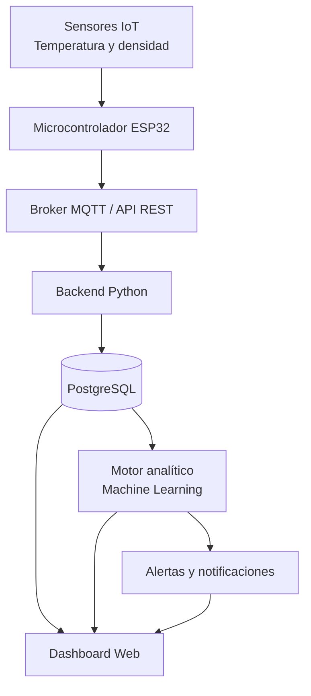

# MOSTO
### Plataforma de Telemetría IoT y Analítica Predictiva para Fermentación Vitivinícola

---

## Descripción

**MOSTO** es una plataforma tecnológica orientada al monitoreo continuo y al análisis predictivo de procesos de fermentación vitivinícola.

Su propósito es apoyar a pequeñas y medianas bodegas mediante la captura de variables críticas, el procesamiento de datos históricos y la detección temprana de condiciones anómalas.

La solución contempla la integración de dispositivos **IoT**, servicios backend, almacenamiento de series temporales, algoritmos de **Machine Learning** y un panel de supervisión web.

> **Estado actual:** Fase 1 — Definición, análisis de requerimientos y diseño de arquitectura.

## Objetivo general

Diseñar y desarrollar una plataforma de monitoreo y analítica predictiva que permita supervisar las condiciones de fermentación vitivinícola, facilitando la identificación temprana de desviaciones térmicas y riesgos de fermentación detenida.

## Objetivos específicos

- Capturar periódicamente mediciones de temperatura y densidad mediante dispositivos IoT.
- Centralizar y almacenar registros de telemetría para su consulta y análisis.
- Implementar mecanismos de procesamiento y validación de datos.
- Desarrollar modelos predictivos para identificar posibles anomalías.
- Visualizar información operativa e histórica mediante un dashboard.
- Incorporar alertas y mecanismos de control de acceso por roles.
- Diseñar una arquitectura modular que facilite el mantenimiento y la evolución del sistema.

---

## Módulos del sistema

| Módulo | Descripción |
|--------|-------------|
| Telemetría IoT | Captura periódica de variables mediante sensores y microcontroladores. |
| Ingesta de datos | Recepción, validación y procesamiento de mediciones mediante MQTT y servicios API. |
| Persistencia | Almacenamiento estructurado de registros y series temporales. |
| Analítica predictiva | Evaluación de datos mediante modelos de Machine Learning. |
| Gestión de alertas | Identificación y notificación de condiciones anómalas. |
| Dashboard web | Visualización de mediciones, tendencias, históricos y predicciones. |
| Gestión de usuarios | Administración de usuarios, roles y permisos de acceso. |

**Nota:** Los módulos descritos corresponden al alcance planificado del proyecto y no representan funcionalidades completamente implementadas.

---

## Arquitectura propuesta

La solución se organiza en capas independientes para separar la captura de información, el procesamiento, la analítica y la presentación.

### Capas de arquitectura

**1. Captura y adquisición**

Obtención periódica de mediciones mediante sensores conectados a microcontroladores ESP32.

**2. Comunicación e ingesta**

Transmisión de datos utilizando MQTT y/o API REST, incorporando mecanismos de validación.

**3. Persistencia y procesamiento**

Almacenamiento de telemetría en PostgreSQL y preparación de los datos para su análisis.

**4. Analítica predictiva**

Procesamiento de series temporales para detectar desviaciones y estimar riesgos durante la fermentación.

**5. Presentación**

Interfaz web destinada a la supervisión de cubas, revisión de históricos y consulta de alertas.

---

## Tecnologías propuestas

| Área | Tecnologías |
|------|-------------|
| Microcontroladores | ESP32 |
| Sensores | DS18B20 y sondas de medición |
| Comunicación | MQTT, HTTP, REST |
| Backend | Python, FastAPI / Flask |
| Base de datos | PostgreSQL |
| Ciencia de datos | Pandas, NumPy |
| Machine Learning | Scikit-learn |
| Frontend | Vue.js |
| Visualización | Chart.js |
| Estilos | Tailwind CSS |
| Contenedorización | Docker, Docker Compose |
| Control de versiones | Git, GitHub |

> Las tecnologías y herramientas pueden ajustarse durante las etapas de implementación y validación.

---

## Flujo general de funcionamiento

1. Los sensores capturan variables asociadas al proceso de fermentación.
2. El microcontrolador transmite las mediciones al servicio de ingesta.
3. El backend recibe y valida los datos.
4. Los registros se almacenan en la base de datos.
5. El módulo analítico procesa la información disponible.
6. Los resultados se presentan en el dashboard.
7. Las condiciones anómalas pueden generar alertas para su revisión.

---

## Metodología de desarrollo

El proyecto contempla un enfoque híbrido que combina prácticas de desarrollo ágil con una metodología específica para proyectos de analítica de datos.

### Scrum

- Organización del trabajo mediante sprints de 2 a 3 semanas.
- Definición y priorización de tareas.
- Revisión periódica de avances.
- Desarrollo incremental de funcionalidades.

### CRISP-DM

Metodología aplicada al componente de Machine Learning:

1. Comprensión del problema.
2. Comprensión de los datos.
3. Preparación de los datos.
4. Modelamiento.
5. Evaluación.
6. Despliegue.

---

## Planificación del proyecto

| Fase | Actividades principales | Estado |
|------|-------------------------|--------|
| Fase 1 | Requerimientos, análisis, UML, arquitectura y modelo de datos | En desarrollo |
| Fase 2 | Prototipo IoT, backend, base de datos, modelos ML y dashboard | Planificada |
| Fase 3 | Pruebas, integración, contenedorización y cierre técnico | Planificada |

### Alcance inicial

La primera etapa se concentra en establecer las bases técnicas y funcionales necesarias para desarrollar una solución consistente, mantenible y escalable.

---

## Seguridad y buenas prácticas

El desarrollo considera las siguientes prácticas de seguridad:

- No almacenar contraseñas, tokens o credenciales en el repositorio.
- Utilizar variables de entorno para configuraciones sensibles.
- Mantener archivos `.env` y credenciales fuera del control de versiones.
- Validar los datos recibidos desde dispositivos y servicios externos.
- Aplicar controles de autenticación y autorización por roles.
- Restringir los permisos de acceso a la base de datos.
- Mantener dependencias actualizadas y revisar vulnerabilidades.
- Evitar exponer información sensible en registros y mensajes de error.
- Utilizar comunicaciones cifradas cuando corresponda.
- Incorporar pruebas y revisiones de código durante el desarrollo.

### Configuración de entorno

Durante la implementación, las configuraciones sensibles deberán administrarse mediante variables de entorno.

Se recomienda utilizar un archivo `.env.example` que contenga únicamente nombres de variables y valores de ejemplo, sin credenciales reales.

### Reporte de vulnerabilidades

Por seguridad, se recomienda informar posibles vulnerabilidades directamente a los responsables del proyecto, evitando publicar credenciales, datos sensibles o instrucciones de explotación en issues públicos.

---

## Organización del repositorio

La documentación y el código fuente se incorporarán progresivamente de acuerdo con las fases del proyecto.

La estructura definitiva se actualizará conforme avance la implementación.

Los documentos correspondientes al análisis y diseño inicial se encuentran en el directorio `Fase 1`.

---

## Equipo de desarrollo

**Proyecto Capstone — Grupo 3**

| Integrante | Responsabilidades |
|------------|-------------------|
| Carlos Cartes | Backend, frontend y arquitectura de software |
| Matías González | Captura IoT, redes y modelo de datos |
| Geraldine Silva | Machine Learning, modelamiento analítico y QA |

---

## Información académica

| Campo | Detalle |
|-------|---------|
| Institución | Duoc UC |
| Asignatura | Proyecto APT (Capstone) |
| Proyecto | MOSTO |
| Versión | 0.1.0 |
| Año | 2026 |
| Estado | Fase 1 — Análisis y diseño |

---

## Estado y disponibilidad

Este repositorio corresponde a un proyecto académico en desarrollo.

La documentación, los componentes de software y las instrucciones de ejecución se actualizarán conforme se implementen y validen las funcionalidades.

Actualmente, no se declara una versión de producción disponible.

## Licencia

El proyecto no cuenta con una licencia de distribución declarada en este README.

La incorporación de una licencia deberá ser acordada por el equipo y los responsables correspondientes.

---

  <strong>MOSTO</strong> 
  Telemetría inteligente y analítica predictiva aplicada a la fermentación vitivinícola.  
  Proyecto APT · Duoc UC · 2026

